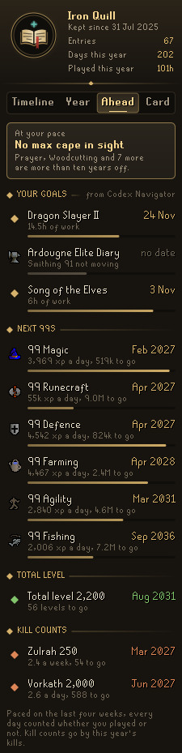
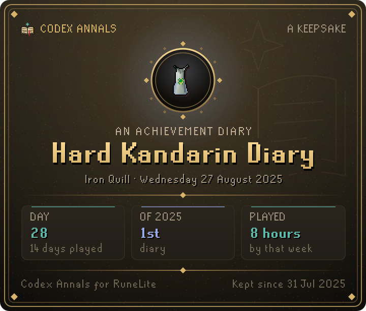

# Codex Annals

**The whole story of your account, written down as it happens.** Codex Annals keeps a lifetime timeline of everything worth remembering: every level and 99, total level milestones, quests, achievement diaries, combat tasks, collection log slots, pets, first kills and kill count milestones, clue milestones and drops worth telling of, each on the day it happened. Every calendar year becomes a **Year in Gielinor**: a full recap in the panel and a gilt-framed card to save or share.

It is part of the **Codex** suite of RuneLite plugins and shares their look: warm ink, aged gold and the game's own fonts.

<p align="center">
  
  
  
  
</p>

## What it does

### Timeline
- **Timeline.** Your account's history, newest first, in chapters by month. Filter it to Skills, Feats (quests, diaries, combat tasks), Loot (log slots, pets, drops, clues) or Bosses. A day of ordinary levels folds into one line, so a long grind never buries a pet. Each line leads with what matters: a drop's value and where it came from, or how far a level still is from 99. At the very end sits the prologue: where the account stood the day the annals began. If a line should not be there, right-click it to strike it from the annals. Each month opens with a line of what it held ("1 99, 3 log slots, 14 levels"), and at the top sits **On this day**: what you did on today's date in earlier years, six months and a month ago. Below it, **Last week** looks back at the last whole week: time played, experience and the skills it went to, kills, levels and log slots, and how the week compares with your usual one. A search box finds any entry by name, skill, boss, item or quest. Every line carries its picture: the item, the skill, a pet's own likeness, or the quest point cape and achievement diary cape for quests and diaries.
- **Today.** At the top of the timeline, the day so far: time played, experience gained and the skills it went to, levels, kills and anything written down, with a bar for how much of your usual day of play it already is. It turns over at midnight on its own, as does every page that speaks of today, even with the client left open.
- **Milestones in chat.** When a 99, a total level or experience milestone, a first kill or a big drop is written down, a short line in the chat box says so, and on the anniversary of something in your annals a line at login remembers it ("On this day in 2025: 99 Slayer"). At your first login of a new week, a line tells what the week before held. Each can be turned off.

### Year
- **Year.** One year told in full: its headline ("The year of 99 Ranged"), hours and days played, levels and experience gained, log slots, quests and diaries, a month-by-month strip lit by how much you played, the skills and bosses it was spent on, its highlights and its records (longest streak, busiest month, biggest drop), then the year set against the one before it. With Codex Ledger installed too, the year's change in worth joins the records.
- **Chapters.** The stretches of weeks your year was spent on, found from what each week's experience and kills went to and named for how long they ran: "A fortnight of Agility", "The Zulrah spring", "The Slayer summer". A week of combat counts as a boss's week when you killed that boss often, or as a Slayer week when Slayer kept pace with your combat; a single week away, or not played, does not end a chapter. They sit on the Year tab under the months.
- **Every day of the year.** Under the months on the Year tab, every day of the year as a small square: gold where you played, teal along the streak still running, and how many days in a row it has gone. Today does not break a streak until the day is out.

### Ahead
- **Ahead.** When each skill reaches 99 at the pace you keep, the next total level, when the max cape falls (or which skills stand in its way), skills at 99 on their way to 200M, and your next kill count milestones. The pace is the last four weeks', counting every day whether you played or not, so the dates are honest ones; until the annals have that, it is this year's so far.
- **Your goals, dated.** Goals you pin in Codex Navigator appear at the top of the Ahead tab with a date. A goal that still needs levels is dated by when each of those levels comes at the pace you really train that skill, and names the one that comes last, or the one you are not training at all. A goal that needs only quests is dated by Navigator's hours of work against the hours a day you really play, days off included.

### Cards
- **Year in Gielinor card.** The year on one page, drawn at double scale so the pixel fonts stay crisp, with your name unless you turn *Name on cards* off, and the year's change in worth only when you turn *Worth on cards* on (and Codex Ledger kept the whole year). It grows all year; save it wherever you choose with RuneLite's file chooser, or copy it to the clipboard. Every earlier year stays one click away.
- **Keepsakes.** Right-click any moment on the timeline, or among the year's highlights, and choose *Make a keepsake card*: that one moment on a gilt page of its own, its picture in a medallion and its name large, the day it came, and three figures from the road to it. For a 99, how many weeks the skill was trained and what the last week brought; for a kill count, the kills that week; for a pet, a quest or a drop, where it sits among the year's (a drop is ranked by value). With them, the day of the annals it came on, the days played by then, and, with *Worth on cards* on, the account's worth that day when Codex Ledger kept a reading within three days of it (otherwise the time played by that week). Whatever else that day held is told beneath. Save it or copy it, as the year card.

<p align="center">
  
  
</p>

## Settings that matter

- **Every level** (on): write down every level; off keeps only every tenth level and the 99s.
- **Notable drop value** (1M): the least a single drop must be worth, at the Grand Exchange price, to be written down.
- **Milestones in chat**, **On this day at login** and **Last week at login** (all on): the lines Annals adds to the chat box.
- **Name on cards** (on) and **Worth on cards** (off): what the Year in Gielinor and keepsake cards print. The panel always shows your worth when Codex Ledger keeps it.

## With other Codex plugins

Annals works on its own. When these are installed too, it reads their saved data, never writes it, and goes on as before if they are removed:

- **Codex Ledger**: your worth over the year, for the Year tab's records and, if you turn *Worth on cards* on, the cards.
- **Codex Navigator**: the goals you pin, dated on the Ahead tab.

## How it keeps the annals

The annals begin the first time you log in with the plugin on. Nothing before that day can be dated, so the prologue records where the account stood instead: total level, experience, combat level, quests done and every skill already at 99.

After that, levels and experience come from the game's stat updates, kill counts, quests, diaries, combat tasks, collection log slots, pets and clues from the game's own chat messages, and drops from RuneLite's loot events, priced at the Grand Exchange price when they dropped. A drop that also fills a collection log slot is one line, not two, and a new pet is written under its own name. Agility lap counts are not kills and are left out. Play time counts while you are logged in, and each year starts from where your skills stood when you first logged in that year. Each week, Monday to Sunday, keeps the experience each skill gained, the kills of each boss and the time played, for five years; when you update from a version without weeks, the last four weeks are filled in from the daily readings the Ahead tab already keeps.

New collection log slots are read from the game's own chat line, so turn on *Collection log - New addition notification* in the game's settings (Chat) to have them written down.

Each level can be written down, or only every tenth level and the 99s. Drops are kept from a value you choose (1M by default). The annals keep their 2,000 most telling entries; ordinary old levels make room first. They are saved about a minute after something is written down, every few minutes otherwise, and when you log out or close the client.

If a save is ever damaged (a figure of the wrong kind, a file cut short), Annals keeps every entry, year and week that still reads rather than starting afresh, and sets the save as it was aside in your profile before writing over it.

## Rules posture

Codex Annals only reads what the game already shows you: your stats, loot events and the game's own chat messages. It does not click, change menus or send anything over the network. The annals are saved per account in your RuneLite profile, and a card is only written when you press Save and pick where it goes.

## Development

```bash
./gradlew build   # compile and run tests
./gradlew run     # launch RuneLite with the plugin loaded
```
