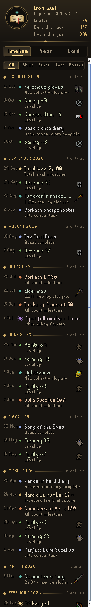
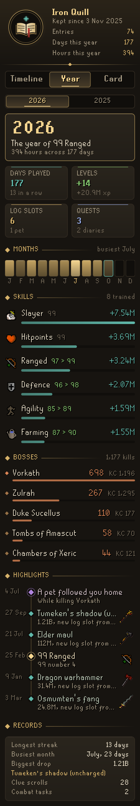
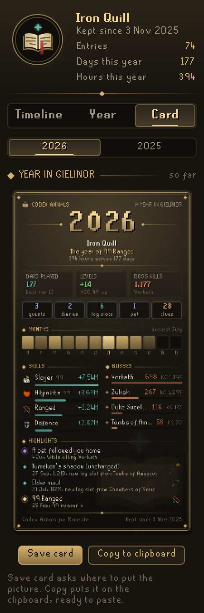
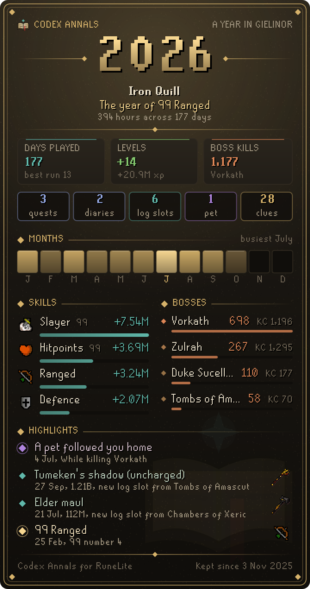

# Codex Annals

**The whole story of your account, written down as it happens.** Codex Annals keeps a lifetime timeline of everything worth remembering: every level and 99, total level milestones, quests, achievement diaries, combat tasks, collection log slots, pets, first kills and kill count milestones, clue milestones and drops worth telling of, each on the day it happened. Every calendar year becomes a **Year in Gielinor**: a full recap in the panel and a gilt-framed card to save or share.

It is part of the **Codex** suite, with [Codex Navigator](https://github.com/Nubles/OSRS-Codex-Navigator), [Codex Guardian](https://github.com/Nubles/OSRS-Codex-Guardian), [Codex Gear Roadmap](https://github.com/Nubles/OSRS-Codex-Gear-Roadmap), [Codex Session Chronicle](https://github.com/Nubles/OSRS-Codex-Session-Chronicle) and [Codex Ledger](https://github.com/Nubles/OSRS-Codex-Ledger), and shares their look: warm ink, aged gold and the game's own fonts.

<p align="center">
  
  
  
</p>

## What it does

- **Timeline.** Your account's history, newest first, in chapters by month. Filter it to Skills, Feats (quests, diaries, combat tasks), Loot (log slots, pets, drops, clues) or Bosses. A day of ordinary levels folds into one line, so a long grind never buries a pet. At the very end sits the prologue: where the account stood the day the annals began.
- **Year.** One year told in full: its headline ("The year of 99 Ranged"), hours and days played, levels and experience gained, log slots, quests and diaries, a month-by-month strip lit by how much you played, the skills and bosses it was spent on, its highlights and its records (longest streak, busiest month, biggest drop).
- **Year in Gielinor card.** The year on one page, drawn at double scale so the pixel fonts stay crisp. It grows all year; save it wherever you choose with RuneLite's file chooser, or copy it to the clipboard. Earlier years stay one click away.
- **Milestones in chat.** When a 99, a total level or experience milestone, a first kill or a big drop is written down, a short line in the chat box says so. This can be turned off.

<p align="center">
  
</p>

## How it keeps the annals

The annals begin the first time you log in with the plugin on. Nothing before that day can be dated, so the prologue records where the account stood instead: total level, experience, combat level, quests done and every skill already at 99.

After that, levels and experience come from the game's stat updates, kill counts, quests, diaries, combat tasks, collection log slots, pets and clues from the game's own chat messages, and drops from RuneLite's loot events, priced at the Grand Exchange price when they dropped. A drop that also fills a collection log slot is one line, not two. Play time counts while you are logged in, and each year starts from where your skills stood when you first logged in that year.

Each level can be written down, or only every tenth level and the 99s. Drops are kept from a value you choose (1M by default). The annals keep their 2,000 most telling entries; ordinary old levels make room first.

## Rules posture

Codex Annals only reads what the game already shows you: your stats, loot events and the game's own chat messages. It does not click, change menus or send anything over the network. The annals are saved per account in your RuneLite profile, and a card is only written when you press Save and pick where it goes.

## Development

```bash
./gradlew build   # compile and run tests
./gradlew run     # launch RuneLite with the plugin loaded
```
